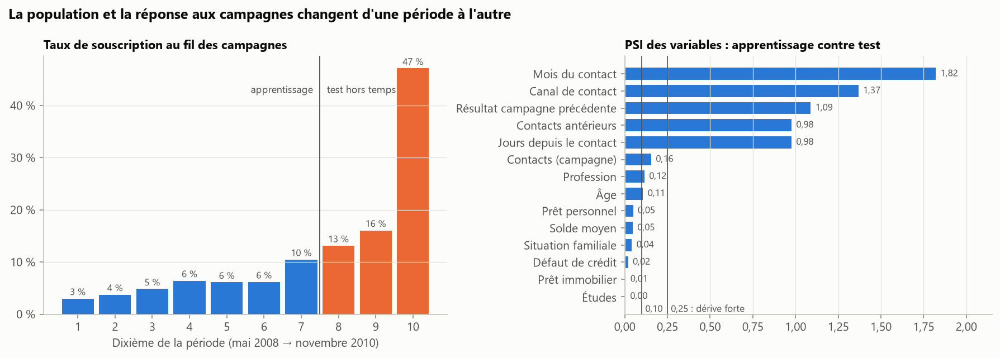
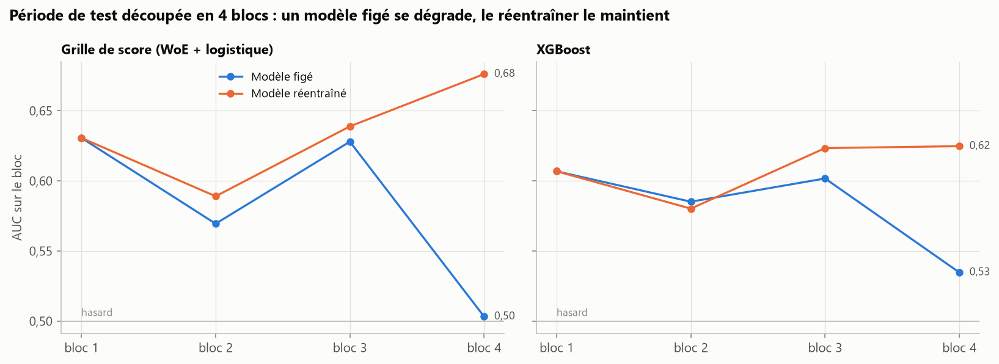
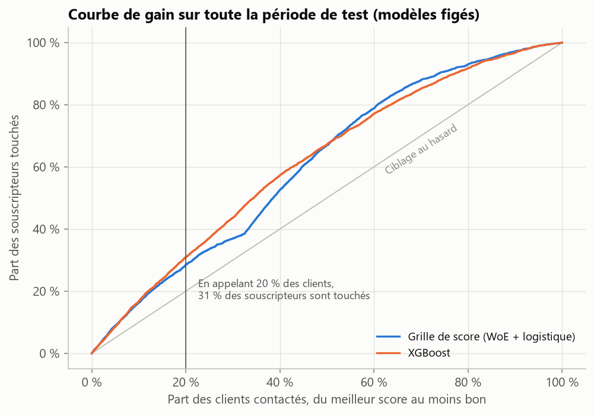
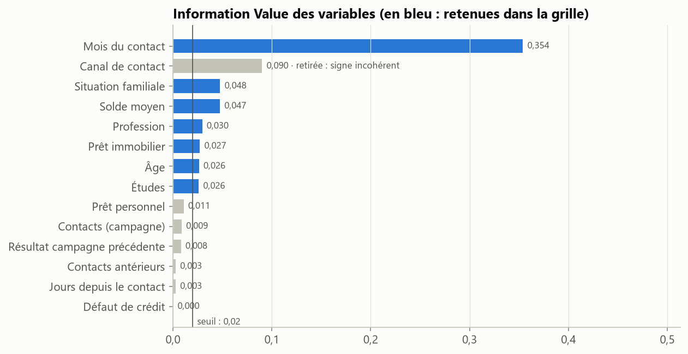

# Score d'appétence bancaire : ce que la validation aléatoire cache

[](https://github.com/narusly/scoring-appetence/actions/workflows/tests.yml)

Quels clients appeler en priorité pour proposer un dépôt à terme ? Deux modèles, une grille de score
(WoE + régression logistique) et XGBoost, sont construits sur 45 211 contacts d'une banque, puis évalués
comme ils le seraient en production : sur une période postérieure à leur apprentissage.

## En bref

- **La validation aléatoire surestime fortement la performance.** AUC de 0,77 avec un découpage aléatoire,
  0,65 en validation hors temps (apprentissage sur le passé, test sur la période suivante).
- **La cause : une dérive massive.** Le taux de souscription passe de 5,8 % à 25,4 % entre les deux
  périodes, et cinq variables ont un PSI supérieur à 0,25, le seuil usuel de dérive forte (mois et canal
  de contact, historique des campagnes précédentes).
- **Un modèle figé finit au niveau du hasard.** Sur le dernier quart de la période de test, la grille figée
  tombe à une AUC de 0,50 ; réentraînée avec toutes les données disponibles, elle remonte à 0,68.
- **La grille de score tient tête à XGBoost** (0,65 contre 0,66 hors temps, 0,68 contre 0,62 après
  réentraînement), tout en restant lisible : chaque client reçoit des points explicables, ce qu'attendent
  les métiers et la réglementation.



## Données

[*Bank Marketing*](https://archive.ics.uci.edu/dataset/222/bank+marketing) (UCI, licence CC BY 4.0 ;
Moro, Cortez et Rita, 2014) : campagnes de télémarketing d'une banque portugaise, de mai 2008 à
novembre 2010, dans l'ordre chronologique. Cible : le client souscrit-il un dépôt à terme ? Les données
sont téléchargées automatiquement au premier lancement.

**Fuite d'information évitée** : la durée de l'appel (`duration`) prédit très bien la souscription, mais
elle n'est connue qu'une fois l'appel terminé. Les auteurs du jeu le signalent ; elle est exclue, tout comme
le jour du mois (`day`).

## Méthode

1. **Validation hors temps** : apprentissage sur les 70 % premiers contacts, test sur les 30 % suivants.
   XGBoost s'arrête tôt sur les 15 % les plus récents de l'apprentissage, jamais sur le test.
2. **Grille de score**
   - discrétisation par quantiles, avec fusion des classes de moins de 3 % ;
   - WoE et Information Value ; sélection des variables d'IV ≥ 0,02 ;
   - régression logistique sur les WoE ;
   - mise à l'échelle : 600 points pour une cote de 1 contre 19, +20 points quand la cote double.
3. **Contrôle des signes** : sur des WoE, tout coefficient doit être positif. Un coefficient négatif trahit
   une colinéarité, et la grille contredirait la WoE (une classe favorable pénalisée). La variable est
   retirée et le modèle réestimé : c'est le cas du canal de contact, colinéaire au mois.
4. **Suivi de la dérive** : Population Stability Index (PSI) de chaque variable entre les deux périodes,
   avec des classes semi-ouvertes ]a ; b] pour isoler une valeur dominante (−1 = « jamais contacté »).
5. **Réentraînement** : la période de test est découpée en quatre blocs ; pour chacun, un modèle figé est
   comparé à un modèle réentraîné sur toutes les données antérieures au bloc.

## Résultats

| Validation | Modèle | AUC | Gini | KS | Souscripteurs touchés en appelant 20 % des clients |
|---|---|---:|---:|---:|---:|
| hors temps | Grille de score | 0,647 | 0,294 | 0,260 | 29 % |
| hors temps | XGBoost | 0,658 | 0,316 | 0,235 | 31 % |
| aléatoire | Grille de score | 0,768 | 0,536 | 0,410 | 55 % |
| aléatoire | XGBoost | 0,744 | 0,488 | 0,348 | 49 % |



Le bloc 1 commence juste après l'apprentissage : modèles figé et réentraîné y sont identiques. La
calibration reste le point faible. Même réentraînés, les modèles sous-estiment le taux de souscription
quand il s'envole (51 % observés sur le bloc 4), parce que l'historique reste dominé par les campagnes
anciennes. En production, il faudrait recalibrer fréquemment ou pondérer les données récentes.

<table>
<tr>
<td></td>
<td></td>
</tr>
</table>

**Lecture de la grille** (extrait, détail dans [`reports/resultats.md`](reports/resultats.md)) :
- un solde moyen supérieur à 2 147 € rapporte 95 points, contre 79 pour un solde nul ou négatif ;
- les célibataires et divorcés obtiennent 92 points, contre 82 pour les personnes mariées ;
- le mois du contact est la variable la plus discriminante, mais aussi la plus instable (PSI de 1,82) : la
  grille s'appuie sur le calendrier des campagnes plus que sur le client.

## Limites et pistes

- Le mois du contact reflète l'organisation des campagnes. Un score durable devrait s'appuyer d'abord sur
  des variables propres au client (épargne, équipement, historique de relation) et être réentraîné à
  intervalle régulier.
- Les variables qui dérivent portent encore de l'information. Les exclure d'office, après les avoir
  repérées en comparant le début et la fin de l'apprentissage, fait baisser l'AUC hors temps de 0,647 à
  0,612 : le suivi de la dérive sert à décider quand réentraîner, pas seulement quoi retirer.
- Pas de coût d'appel ni de marge par souscription dans les données : le seuil de ciblage optimal reste à
  fixer avec les métiers.

## Reproduire

```bash
python -m venv .venv
source .venv/bin/activate            # Windows : .venv\Scripts\activate
pip install -e ".[dev]"
pytest                               # 10 tests
python -m appetence.report           # télécharge les données, régénère reports/ (environ 30 secondes)
```

## Structure

```
src/appetence/data.py        téléchargement UCI, variables exclues, découpage temporel
src/appetence/scorecard.py   discrétisation, WoE, IV, logistique avec contrôle des signes, points
src/appetence/metrics.py     AUC, Gini, KS, capture, courbe de gain, PSI
src/appetence/report.py      analyse complète, tableaux et figures
tests/                       WoE à la main, propriété des points, PSI, signes, absence de fuite
```

---
Maxime Fruntes · Master 2 Mathématiques appliquées (Probabilités et Statistiques), Université de Lorraine ·
[LinkedIn](https://www.linkedin.com/in/maxime-fruntes-2538543a5/) · Licence MIT
